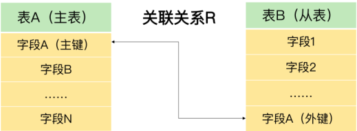
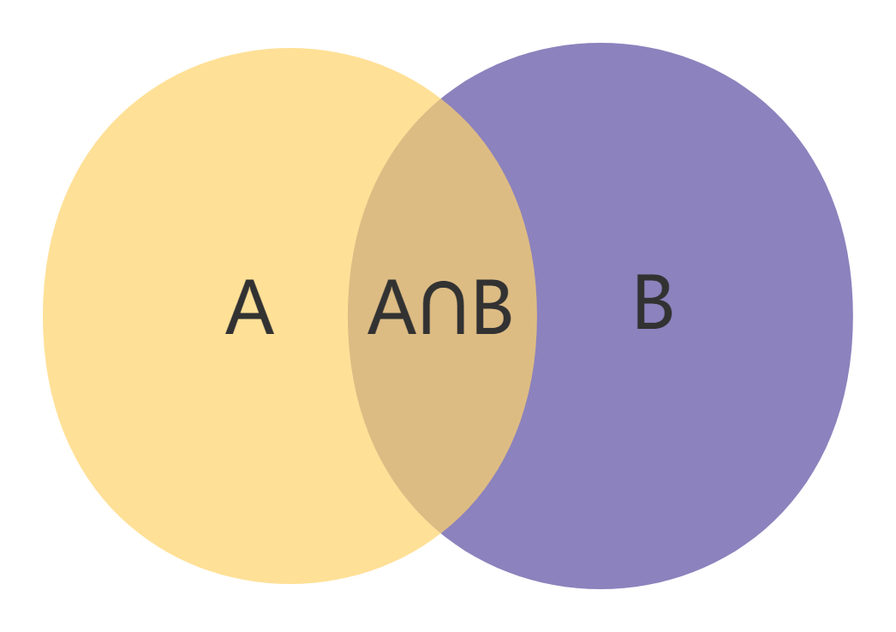

1. MySQL Server：是 MySQL 数据库服务器，这是 MySQL 的核心组件
2. MySQL Router：在应用和数据库服务器之间，起到路由和负载均衡的作用的插件。场景：假设有多个 MySQL 数据库服务器，而前端应用同时产生了很多数据库访问请求，MySQL Router对这些请求进行调度，把访问均衡地分配给每个数据库服务器，而不是集中在一个或几个数据库服务器上。
3. MySQL 数据库的连接方式配置
    - 网络通讯协议（TCP/IP）
    - 命名管道（Named Pipe）
    - 共享内存（Shared Memory）
    - 命名管道和共享内存速度快，但都只能从本机访问MySQL数据库服务器。这里我们选择默认的网络通讯协议方式，这样MySQL数据库服务就可以通过网络进行访问。
4. information_schema、performance_schema、sys、mysql 作用
    1. “information_schema”主要保存MySQL数据库服务器的系统信息，比如数据库的名称、数据表的名称、字段名称、存取权限、数据文件所在的文件夹和系统使用的文件夹，等等
    2. “performance_schema”可以用来监控 MySQL 的各类性能指标
    3. “sys”主要展示MySQL数据库服务器的各类性能指标，帮助系统管理员和开发人员监控 MySQL的技术性能
    4. “mysql”保存了 MySQL 数据库服务器运行时需要的系统信息，比如数据文件夹、当前使用的字符集、约束检查信息，等等
5. 主键确保数据的唯一性，能减少数据错误并提高查询速度
    - 必须可以唯一标识数据表中的记录;
    - 不能是空；
    - 必须唯一，不能重复

| 类型 | 有符号数取值范围 | 无符号数取值范围 | 占用字节数 | 适用场景 |
| :---: | :---: | :---: | :---: | :---: |
| TINYINT | -128~127 | 0~255 | 1 | 一般用于枚举数据，比如系统设定等取值范围很小且固定的场景 |
| SMALLINT | -32768~32767 | 0~65535 | 2 | 可以用于较小范围的统计数据，比如统计工厂的固定资产库存数量等 |
| MEDIUMINT | -8388608~8388607 | 0~16777215 | 3 | 用于较大整数的计算，比如车站每日的客流量等 |
| INT (INTEGER) | -2147483648~2147483647 | 0~4294967295 | 4 | 取值范围足够大，一般情况下不用考虑超限问题，用得最多 |
| BIGINT | -9223372036854775808~9223372036854775807 | 0~18446744073709551615 | 8 | 只有当你处理特别巨大的整数时才会用到。比如双十一的交易量、大型门户网站点击量、证券公司衍生产品持仓等 |

## 在评估用哪种整数类型的时候，你需要考虑存储空间和可靠性的平衡问题
- 在实际工作中，系统故障产生的成本远远超过增加几个字段存储空间所产生的成本。
  因此，我建议你首先确保数据不会超过取值范围，在这个前提之下，再去考虑如何节省存储空间。

| 类型 | 有符号数取值范围 | 无符号数取值范围 | 占用字节数 |
| :---: | :--- | :--- | :---: |
| FLOAT | (-3.402823466E+38, -1.175494351E-38), 0,<br>(1.175494351 E-38, 3.402823466351 E+38) | 0, (1.175494351 E-38,<br>3.402823466 E+38) | 4 |
| DOUBLE | (-1.7976931348623157E+308, -<br>2.2250738585072014E-308), 0,<br>(2.2250738585072014E-308,<br>1.7976931348623157E+308) | 0, (2.2250738585072014E-308,<br>1.7976931348623157E+308) | 8 |

- 浮点数类型有个缺陷，就是不精准

7. MySQL 对浮点类型数据的存储方式上
    - MySQL 用 4 个字节存储 FLOAT 类型数据，用 8 个字节来存储 DOUBLE 类型数据。
    无论哪个，都是采用二进制的方式来进行存储的。比如 9.625，用二进制来表达，就是
    1001.101，或者表达成 1.001101×2^3。看到了吗？如果尾数不是 0 或 5（比如9.624），
    你就无法用一个二进制数来精确表达。怎么办呢？就只好在取值允许的范围内进行近似（四舍五入）。
8. MySQL 有没有精准的数据类型呢？当然有，这就是定点数类型：DECIMAL
    - MySQL 用 DECIMAL（M,D）的方式表示高精度小数。其中，M 
      表示整数部分加小数部分，一共有多少位，M<=65。D 表示小数部分位数，D<M

| listnumber (单号) | supplierid (供货商编号) | stocknumber (仓库编号) | importtype (进货方式) | quantity (进货数量) | importvalue (进货金额) | Recorder (录入人编号) | recordingdate (录入时间) |
| :--- | :--- | :--- | :--- | :--- | :--- | :--- | :--- |
| 1234 | 1 | 1 | 1 | 10 | 100 | 1 | 2020-12-20 |
| 2345 | 1 | 1 | 2 | 20 | 200 | 1 | 2020-12-21 |
| 3456 | 1 | 1 | 3 | 5 | 50 | 1 | 2020-12-25 |

```sql
create table demo.test ([field] [type], ..., ...);
-- 添加主键
alter table demo.test add column id int primary key not null auto_increment;
-- 插入数据
insert into demo.test (id) values (1), (2), (3);
-- 修改字段类型语句
alter table demo.test modify column price double;
-- 计算字段合计函数
select sum(price) from demo.goodsmaster;
```

| 类型 | 描述 | 长度/取值特点 |
|------|------|---------------|
| **CHAR(M)** | 固定长度字符串。必须预先定义字符串长度。 | 如果太短，数据可能会超出范围；如果太长，又浪费存储空间。 |
| **VARCHAR(M)** | 可变长度字符串。需要预先知道字符串的最大长度。 | 只要不超过这个最大长度，具体存储时按实际字符串长度存储。 |
| **TEXT** | 字符串。 | 系统自动按照实际长度存储，不需要预先定义长度。 |
| **ENUM** | 枚举类型。 | 取值必须是预先设定的一组字符串值范围之内的一个，必须要知道字符串所有可能的取值。 |
| **SET** | 是一个字符串对象。 | 取值必须是在预先设定的字符串值范围之内的 0 个或多个，也必须知道字符串所有可能的取值。 |

| 类型 | 最大长度（字符数） | 备注 |
|------|-------------------|------|
| **TINYTEXT** | 255 | 假设字符是 ASCII 码，一个字符占用一个字节 |
| **TEXT** | 65535 | 同上 |
| **MEDIUMTEXT** | 16777215 | 同上 |
| **LONGTEXT** | 4294967295 | 相当于 4GB |

> 说明：TEXT 类型共有 4 种，它们的区别就是最大长度不同。

- TEXT 也有一个问题：由于实际存储的长度不确定，MySQL 不允许TEXT 类型的字段做主键。遇到这种情况，你只能采用 CHAR(M)，或者VARCHAR(M)。

> 所以，我建议你，在你的项目中，只要不是主键字段，就可以按照数据可能的最大长度，选择这几种 TEXT 类型中的的一种，作为存储字符串的数据类型。

| 类型 | 日期格式 | 范围 | 占用字节数 |
|------|----------|------|-----------|
| **YEAR** | YYYY | 1901 ～ 2155 | 1 |
| **TIME** | HH:MM:SS | -838:59:59 ～ 838:59:59 | 3 |
| **DATE** | YYYY-MM-DD | 1000-01-01 ～ 9999-12-3 | 3 |
| **DATETIME** | YYYY-MM-DD HH:MM:SS | 1000-01-01 00:00:00 ～ 9999-12-31 23:59:59 | 8 |
| **TIMESTAMP** | YYYY-MM-DD HH:MM:SS | 1970-01-01 00:00:01 UTC ～ 2038-01-19 03:14:07 UTC | 4 |

> 不过，我也给你一条小建议：为了确保数据的完整性和系统的稳定性，优先考虑使用DATETIME 类型。因为虽然 DATETIME 类型占用的存储空间最多，但是它表达的时间最为完整，取值范围也最大。

> 最后，我还想再给你分享 1 个小技巧。在定义数据类型时，如果确定是整数，就用 INT；如果是小数，一定用定点数类型 DECIMAL；如果是字符串，只要不是主键，就用 TEXT；如果是日期与时间，就用 DATETIME。

- 整数 : int
- 小数 : decimal
- 字符串 : text
- 时间 : datetime


### importhead 进货单投表

| listnumber<br>(单号) | supplierid<br>(供货商编号) | stocknumber<br>(仓库编号) | importtype<br>(进货方式) | quantity<br>(进货数量) | importvalue<br>(进货金额) | Recorder<br>(录入人编号) | recordingdate<br>(录入时间) |
|----------------------|----------------------------|---------------------------|--------------------------|------------------------|---------------------------|--------------------------|-----------------------------|
| 1234 | 1 | 1 | 1 | 10 | 100 | 1 | 2020-12-20 |
| 2345 | 1 | 1 | 2 | 20 | 200 | 1 | 2020-12-21 |
| 3456 | 1 | 1 | 3 | 5  | 50  | 1 | 2020-12-25 |

> 这里的 1、2、3 表示门店的 3 种进货方式，分别是配送中心配送、门店采买和供货商直供

```sql
create table <表名> (
字段名1 数据类型 [字段级别约束] [默认值]，
字段名2 数据类型 [字段级别约束] [默认值]，
......
[表级别约束]
)

create table demo.importhead (
    listnumber int,
    supplierid int,
    stocknumber int,
    -- 我们在字段importype定义为INT类型的后面，按照MySQL创建表的语法，加了默认值1。
    importtype int default 1,
    quantity decimal(10, 3),
    importvalue decimal(10, 2),
    recorder int,
    recordingdate datetime
);

insert into demo.importhead (listnumber, supplierid, stocknumber, quantity, importvalue, recorder, recordingdate) values (3456,1,1,10,100,1,'2020-12-10');
```

- 在 MySQL 创建表的语法结构里面，有一个词叫做“约束”。“约束”限定了表中数据应该满足的条件。MySQL 会根据这些限定条件，对表的操作进行监控，阻止破坏约束条件的操作执行，并提示错误，从而确保表中数据的唯一性、合法性和完整性。这是创建表时不可缺少的一部分

- 除了默认约束，还有主键约束、外键约束、非空约束、唯一性约束和自增约束

1. 非空约束
    - 非空约束表示字段值不能为空，如果创建表的时候，指明某个字段非空，那么添加数据的时候，这个字段必须有值，否则系统就会提示错误。
2. 唯一性约束
    - 唯一性约束表示这个字段的值不能重复，否则系统会提示错误。跟主键约束相比，唯一性约束要更加弱一些。在一个表中，我们可以指定多个字段满足唯一性约束，而主键约束则只能有一个，这也是MySQL 系统决定的。另外，满足主键约束的字段，自动满足非空约束，但是满足唯一性约束的字段，则可以是空值。
    - 为了方便你理解，我来举个例子。比如，我们有个商品信息表 goodsmaster，如下所示

            | barcode | goodsname | price |
            |---------|-----------|-------|
            | 0001    | book      | 89    |
            | 0002    | pen       | 12    |

        ```text
        barcode 代表条码，goodsname 代表名称。为了防止条码重复，我们可以定义字段“barcode”满足唯一性约束。这样一来，条码就不能重复，但是可以为空，而且只能有一条记录条码为空。同样道理，为了防止名称重复，我们也可以定义字段“goodsname”满足唯一性约束。但是，由于无论名称和条码都可能重用，或者可能为空，都不适合做主键。因此，对这个表来说，可以添加一个满足唯一性要求的新字段来做主键。
        ```
3. 自增约束
    - 自增约束可以让 MySQL 自动给字段赋值，且保证不会重复

            | barcode | goodsname | price |
            |---------|-----------|-------|
            | 0001    | 书        | 89    |
            | 0002    | 馒头      | 1.5   |
            | 0002    | 花卷      | 1.8   |
    
    - 从这个表中，我们可以看到，barcode、goodsname 和 price 都不能确保唯一性，所以没有任何一个字段可以做主键，因此，我们可以自己添加一个字段 itemnumber，并且每次添加一条数据的时候，要给值增加 1。怎么实现呢？我们就可以通过定义自增约束的方式，让系统自动帮我们赋值，从而满足唯一性，这样就可以做主键了。

            | itemnumber | barcode | goodsname | price |
            |------------|---------|-----------|-------|
            | 1          | 0001    | 书        | 89    |
            | 2          | 0002    | 馒头      | 1.5   |
            | 3          | 0002    | 花卷      | 1.8   |
    
    - 有 2 个问题需要你注意一下: 第一，在数据表中，只有整数类型的字段（包括TINYINT、SMALLINT、MEDIUMINT、INT 和 BIGINT），才可以定义自增约束。自增约束的字段，每增加一条数据，值自动增加1。
    - 第二，你可以给自增约束的字段赋值，这个时候，MySQL 会重置自增约束字段的自增基数，下次添加数据的时候，自动以自增约束字段的最大值加 1 为新的字段值。

```sql
CREATE TABLE(字段名 字段类型 PRIMARY KEY);
CREATE TABLE(字段名 字段类型 NOT NULL);
CREATE TABLE(字段名 字段类型 UNIQUE);
CREATE TABLE(字段名 字段类型 DEFAULT 值);
-- 这里要注意自增类型的条件，字段类型必须是整数类型。
CREATE TABLE(字段名 字段类型 AUTO_INCREMENT);
-- 在一个已经存在的表基础上，创建一个新表
CREATE demo.importheadhist LIKE demo.importhead;
-- 修改表的相关语句
ALTER TABLE 表名 CHANGE 旧字段名 新字段名 数据类型;
ALTER TABLE 表名 ADD COLUMN 字段名 字段类型 FIRST|AFTER 字段名;
ALTER TABLE 表名 MODIFY 字段名 字段类型 FIRST|AFTER 字段名;

-- 可以在表一级指定表的存储引擎
alter table 表名 ENGINE=INNODB;

可以通过指定关键字 AUTO_EXTENDSIZE，来指定存储文件自增空间的大小，从而提高存储空间的利用率

可以通过 INVISIBLE 关键字，使字段不可见，但却可以使用
```

10. 我们在插入一条数据记录的时候，必须要考虑字段约束的 3 种情况
    1. 如果字段允许为空，而我们没有给它赋值，那么 MySQL 会自动给它们赋予空值。在刚刚的代码中，“specification”“unit”字段都允许为空，因此，如果数据插入语句没有指定这几个字段的值，MySQL 会自动插入空值。
    2. 如果字段是主键，就不能为空，这个时候，MySQL 会按照我们添加的约束进行处理。比如字段“itemnumber”是主键，不能为空，而我们定义了自增约束，所以MySQL 自动在之前的最大值基础上加了 1。因此，“itemnumber”也有了自己该有的值。
    3. 如果有一个字段定义不能为空，又不是主键，当你插入一条数据记录的时候，就必须给这个记录赋值。

    - 部分插入一条数据记录是可以的，但前提是，没有赋值的字段，一定要让 MySQL 知道如何处理，比如可以为空、有默认值，或者是自增约束字段，等等，否则，MySQL 会提示错误的

    ```
    我们的项目就有这样的场景：门店每天的销售流水都很多，日积月累，流水表变得越来越大。如果就让它这么不断地增长，数据量甚至会达到数亿条，占据的存储空间达到几十个G。虽然 MySQL 可以处理这样比较大的数据表，但是每次操作的响应时间就会延长，这会导致系统的整体效率下降。刚开始的时候，我们开发了一个日结处理，当天算清所有账目。其中一个步骤就是，把当天流水表的数据全部转到历史流水表当中去。现在，我们就可以用上数据插入语句了。具体有 2 步：
    ```

    1. 从流水表中取出一条数据；
    2. 把这条数据插入到历史流水表中。

    ### 插入查询结果
    ```sql
    insert into 表名 （字段名）SELECT 字段名或值 FROM 表名 WHERE 条件

    INSERT INTO 历史流水表 （日结时间字段，其他字段）SELECT 获取当前时间函数，其他字段 FROM 流水表
    ```

    ### 删除数据
    ```sql
    delete from tablename where condition
    ```

    ### 修改数据
    ```sql
    update tablename
    set fieldname=val
    where cond

    -- 语法很简单，需要注意的一点是，不要修改主键字段的值。因为主键是数据记录的唯一标识，如果修改了主键的值，就有可能会破坏数据的完整性
    ```

    ### 查询数据
    ```sql
    SELECT *|字段列表
    FROM 数据源
    WHERE 条件
    GROUP BY 字段
    HAVING 条件
    ORDER BY 字段
    LIMIT 起始点，行数

    -- GROUP BY：作用是告诉 MySQL，查询结果要如何分组，经常与 MySQL 的聚合函数一起使用。HAVING：用于筛选查询结果，跟 WHERE 类似

    -- 数据源也不一定是表，也可以是一个查询的结果。比如下面的查询
    ```

    - 派生表（derived table），或者子查询（subquery），意思是我们把一个查询结果数据集当做一个虚拟的数据表来看待。MySQL 规定，必须要用 AS 关键字给这个派生表起一个别名

    ### ORDER BY
    - ASC DESC

    ### LIMIT
    - “LIMIT 1,2”中，“1”表示起始位置，MySQL 中，起始位置的起点是 0，1 表示从第 2 条记录开始；“2”表示 2 条数据。因此，“LIMIT 1,2”就表示从第 2 条数据开始，显示 2 条数据，也就是显示了第 2、3 条数据。

    ## 总结
    ```sql
    INSERT INTO 表名 [(字段名 [,字段名] ...)] VALUES (值的列表);
    INSERT INTO 表名 （字段名）SELECT 字段名或值 FROM 表名 WHERE 条件
    DELETE FROM 表名 WHERE 条件
    UPDATE 表名 SET 字段名=值 WHERE 条件
    SELECT *|字段列表 FROM 数据源 WHERE 条件 GROUP BY 字段 HAVING 条件 ORDER BY 字段 LIMIT 起始点，行数
    ```

    - 如果我们把查询的结果插入到表中时，导致主键约束或者唯一性约束被破坏了，就可以用“ON DUPLICATE”关键字进行处理。这个关键字的作用是，告诉MySQL，如果遇到重复的数据，该如何处理, 假设用户有 2 个各自独立的门店，分别有自己的系统。现在需要引入连锁经营的模式，把2 个店用一套系统统一管理。那么首先遇到的问题就是，需要进行数据整合。下面我们就以商品信息表为例，来说明如何通过使用“ON DUPLICATE”关键字，把两个门店的商品信息数据整合到一起。

    ```sql
    MySQL  localhost:3306 ssl  demo  SQL > select * from demo.goodsmaster;
    +------------+---------+-----------+---------------+------+------------+
    | itemnumber | barcode | goodsname | specification | unit | salesprice |
    +------------+---------+-----------+---------------+------+------------+
    |          1 | 0001    | 书        | 16开          | 本   |      89.00 |
    |          2 | 0002    | 笔        | 10支装        | 包   |       5.00 |
    |          3 | 0003    | 橡皮      | NULL          | 个   |       3.00 |
    +------------+---------+-----------+---------------+------+------------+
    3 rows in set (0.0008 sec)
    MySQL  localhost:3306 ssl  demo  SQL > select * from demo.goodsmaster1;
    +------------+---------+-----------+---------------+------+------------+
    | itemnumber | barcode | goodsname | specification | unit | salesprice |
    +------------+---------+-----------+---------------+------+------------+
    |          1 | 0001    | 教科书    | NULL          | NULL |      89.00 |
    |          4 | 0004    | 馒头      | NULL          | NULL |       1.50 |
    +------------+---------+-----------+---------------+------+------------+
    ```

    ```sql
    -- 假设我们要把门店 B 的商品数据，插入到门店 A 的商品表中去，如果有重复的商品编号，就用门店 B 的条码，替换门店 A 的条码，用门店 B 的商品名称，替换门店 A 的商品名称；如果没有重复的编号，就直接把门店 B 的商品数据插入到门店 A 的商品表中

    insert into demo.goodsmaster select * from demo.goodsmaster1 as a
    on duplicate key update barcode=a.barcode,goodsname=a.goodsname;
    ```

    ```
    商品表 demo.goodsmaster 中，字段“itemnumber”是主键，
    而且满足自增约束，如果我删除了一条记录，再次插入数据的时候，就会出现字
    段“itemnumber”的值不连续的情况。请你想一想，如何插入数据，才能防止这种情况
    的发生呢？
    ```


| cardno (卡号) | membername (名称) | memberphone (电话) | memberpid (身份证号) | address (地址) | sex (性别) | birthday (生日) |
| :---: | :---: | :---: | :---: | :---: | :---: | :---: |
| 10000001 | 张三 | 13812345678 | 110123200001017890 | 北京 | 男 | 2000-01-01 |
| 10000002 | 李四 | 13512312312 | 123123199001012356 | 上海 | 女 | 1990-01-01 |

11. 业务字段做主键、自增字段做主键和手动赋值字段做主键
    1. 业务字段做主键
        - 会员卡号（cardno）不能为空，而且有唯一性，可以用来标识一条会员记录。我们来尝试一下用会员卡号做主键
        ```sql
        create table demo.membermaster(
            cardno char(8) primary key, -- 会员卡号作为主键
            membername text,
            memberphone text,
            memberpid text,
            memberaddress text,
            sex text,
            birthday datetime
        );

        insert into demo.membermaster (cardno, membername, memberphone, memberpid, memberaddress, sex, birthday) values ('10000001','张三','13812345678','110123200001017890', '北京','男','2000-01-01');

         insert into demo.membermaster (cardno, membername, memberphone, memberpid, memberaddress, sex, birthday) values ('10000002','李四','13512345678',
         '123123199001012356','上海','女','1990-01-01');
        ```

        | transactionno (流水单号) | itemnumber (商品编号) | quantity (销售数量) | price (价格) | salesvalue (销售金额) | cardno (会员卡号) | transdate (交易时间) |
        | :---: | :---: | :---: | :---: | :---: | :---: | :---: |
        | 1 | 1 | 1 | 89 | 89 | 10000001 | 2020-12-01 |

        ```sql
        create table demo.trans (
            transactionno int,
            itemnumber int, -- 为了引用商品信息
            quantity decimal(10, 3),
            price decimal(10, 2),
            salesvalue decimal(10, 2),
            cardno char(8), -- 为了引用会员信息
            transdate datetime
        );

        insert into demo.trans (transactionno,itemnumber,quantity,price,salesvalue,cardno,transdate) VALUES(1,1,1,89,89,'10000001','2020-12-01');

        select b.membername, c.goodsname, a.quantity, a.salesvalue, a.transdate from 
        demo.trans as a 
        join demo.membermaster as b
        join demo.goodsmaster as c
        on (a.cardno=b.cardno and a.itemnumber=c.itemnumber); 

        update demo.membermaster set membername='five' where cardno='10000001';

        select b.membername, c.goodsname, a.quantity, a.salesvalue, a.transdate from 
        demo.trans as a 
        join demo.membermaster as b
        join demo.goodsmaster as c
        on (a.cardno=b.cardno and a.itemnumber=c.itemnumber); 

        +------------+-----------+----------+------------+---------------------+
        | membername | goodsname | quantity | salesvalue | transdate           |
        +------------+-----------+----------+------------+---------------------+
        | five       | books     |    1.000 |      89.00 | 2020-12-01 00:00:00 |
        +------------+-----------+----------+------------+---------------------+ 
        ```

        - 不要使用业务字段作为主键 即使能够满足唯一性 如 身份证 手机号 等 其持有人都有可能变更
        - 尽量不要用业务字段，也就是跟业务有关的字段做主键

        ```sql
        alter table demo.membermaster drop primary key;
        alter table demo.membermaster add column id int primary key auto_increment;

        update demo.trans as a , demo.membermaster as b 
        set a.memberid=b.id
        where a.transactionno > 0 and a.cardno=b.cardno;

        insert into demo.membermaster ( cardno, membername, memberphone, memberpid, memberaddress, sex, birthday ) VALUES ( '10000001', '王五', '13698765432','475145197001012356', '天津', '女', '1970-01-01' );

        select b.membername, c.goodsname, a.quantity, a.salesvalue, a.transdate from 
        demo.trans as a 
        join demo.membermaster as b
        join demo.goodsmaster as c
        on (a.cardno=b.cardno and a.itemnumber=c.itemnumber); 
        ```

        - 如果是一个小项目，只有一个 MySQL 数据库服务器，用添加自增字段作为主键的办法是可以的。不过，这并不意味着，在任何情况下你都可以这么做。
        ```
        举个例子，用户要求把增加新会员的工作放到门店进行，因为发展新会员的工作一般是在门店进行的，毕竟，人们一般都是在购物的同时申请会员。解决的办法是，门店的信息系统添加新增会员的功能，把新的会员信息先存放到本地 MySQL 数据库中，再上传到总部，进行汇总。可是问题来了，如果会员信息表的主键是自增的，那么各个门店新加的会员就会出现“id”冲突的可能。比如，A 店的 MySQL 数据库中的 demo.membermaster 中，字段“id”的值是 100，这个时候，新增了一个会员，“id”是 101。同时，B 店的字段“id”值也是 100，要加一个新会员，“id”也是 101，毕竟，B 店的 MySQL 数据库与 A 店相互独立。等 A 店与B 店都把新的会员上传到总部之后，就会出现两个“id”是 101，但却是不同会员的情况，这该如何处理呢？
        ```

        - 手动赋值字段做主键
        ```
        为了解决这个问题，我们想了一个办法：取消字段“id”的自增属性，改成信息系统在添加会员的时候对“id”进行赋值。具体的操作是这样的：在总部 MySQL 数据库中，有一个管理信息表，里面的信息包括成本核算策略，支付方式等，还有总部的系统参数，我们可以在这个表中添加一个字段，专门用来记录当前会员编号的最大值。门店在添加会员的时候，先到总部 MySQL 数据库中获取这个最大值，在这个基础上加1，然后用这个值作为新会员的“id”，同时，更新总部 MySQL 数据库管理信息表中的当前会员编号的最大值。这样一来，各个门店添加会员的时候，都对同一个总部 MySQL 数据库中的数据表字段进行操作，就解决了各门店添加会员时会员编号冲突的问题，同时也避免了使用业务字段导致数据错误的问题。
        ```

    ## 总结

    - 用业务字段做主键，看起来很简单，但是我们应该尽量避免这样做。因为我们无法预测未来会不会因为业务需要，而出现业务字段重复或者重用的情况。自增字段做主键，对于单机系统来说是没问题的。但是，如果有多台服务器，各自都可以录入数据，那就不一定适用了。因为如果每台机器各自产生的数据需要合并，就可能会出现主键重复的问题。我们可以采用手动赋值的办法，通过一定的逻辑，确保字段值在全系统的唯一性，这样就可以规避主键重复的问题了


12. 外键和链接：如何做关联查询？

    - 进货单头表（importhead）

    | listnumber (进货单号) | supplierid (供货商编号) | stocknumber (仓库编号) | importtype (进货类别) | totalquantity (总计数量) | totalvalue (总计金额) | recorder (录入人编号) | recordingdate (录入时间) |
    | :---: | :---: | :---: | :---: | :---: | :---: | :---: | :---: |
    | 1234 | 1 | 1 | 1 | 30 | 1110 | 1 | 2020-12-20 |

    - 进货单明细表（importdetails）

    | listnumber (进货单号) | itemnumber (商品编号) | quantity (进货数量) | Importprice (进货价格) | importvalue (进货金额) |
    | :---: | :---: | :---: | :---: | :---: |
    | 1234 | 1 | 10 | 89 | 890 |
    | 1234 | 2 | 20 | 12 | 240 |

    - 外键就是从表中用来引用主表中数据的那个公共字段

    

    - 在 MySQL 中，外键是通过外键约束来定义的。外键约束就是约束的一种，它必须在从表中定义，包括指明哪个是外键字段，以及外键字段所引用的主表中的主键字段是什么。MySQL 系统会根据外键约束的定义，监控对主表中数据的删除操作。如果发现要删除的主表记录，正在被从表中某条记录的外键字段所引用，MySQL 就会提示错误，从而确保了关联数据不会缺失

    ```sql
    [CONSTRAINT <外键约束名称>] FOREIGN KEY 字段名 REFERENCES <主表名> 字段名

    CREATE TABLE 从表名 (
    字段名 类型,
    ...
    -- 定义外键约束，指出外键字段和参照的主表字段
    CONSTRAINT 外键约束名 FOREIGN KEY (字段名) REFERENCES 主表名 (字段名)
    )

    ALTER TABLE 从表名 ADD CONSTRAINT 约束名 FOREIGN KEY 字段名 REFERENCES 主表名 (字段名);


    CREATE TABLE demo.importhead (
        listnumber INT PRIMARY KEY,
        supplierid INT,
        stocknumber INT,
        importtype INT,
        importquantity DECIMAL(10 , 3 ),
        importvalue DECIMAL(10 , 2 ),
        recorder INT,
        recordingdate DATETIME
    );

    CREATE TABLE demo.importdetails (
    listnumber INT,
    itemnumber INT,
    quantity DECIMAL(10,3),
    importprice DECIMAL(10,2),
    importvalue DECIMAL(10,2),
    -- 定义外键约束，指出外键字段和参照的主表字段
    CONSTRAINT fk_importdetails_importhead FOREIGN KEY (listnumber) REFERENCES importhead (listnumber)
    );


    SELECT
        constraint_name, -- 表示外键约束名称
        table_name, -- 表示外键约束所属数据表的名称
        column_name, -- 表示外键约束的字段名称
        referenced_table_name, -- 表示外键约束所参照的数据表名称
        referenced_column_name -- 表示外键约束所参照的字段名称
    FROM
        information_schema.KEY_COLUMN_USAGE
    WHERE
        constraint_name = 'fk_importdetails_importhead';
    ```

    - INNER JOIN：两圆交集 
    - LEFT JOIN：整个左圆
    - RIGHT JOIN：整个右圆
    - FULL JOIN：两个圆的并集

    

    ```sql
    CREATE TABLE 从表名 (
    字段 字段类型
    ....
    CONSTRAINT 外键约束名称 FOREIGN KEY (字段名) REFERENCES 主表名 (字段名称)
    );
    ALTER TABLE 从表名 ADD CONSTRAINT 约束名 FOREIGN KEY 字段名 REFERENCES 主表名 （字段
    -- 连接查询
    SELECT 字段名 FROM 表名 AS a JOIN 表名 AS b ON (a.字段名称=b.字段名称);
    SELECT 字段名 FROM 表名 AS a LEFT JOIN 表名 AS b ON (a.字段名称=b.字段名称);
    SELECT 字段名 FROM 表名 AS a RIGHT JOIN 表名 AS b ON (a.字段名称=b.字段名称);
    ```

    ### demo.trans
    | transactionnumber (流水单号) | Itemnumber (商品编号) | price (价格) | quantity (数量) | cardno (会员卡号) | transdate (交易时间) |
    | :---: | :---: | :---: | :---: | :---: | :---: |
    | 1 | 1 | 89 | 1 | 10000001 | 2020-12-01 |
    | 2 | 2 | 12 | 1 | NULL | 2020-12-02 |

    ### demo.membermaster
    | cardno (会员卡号) | membername (会员名称) | memberphone (会员电话) | memberpid (会员身份证号) | sex (会员性别) |
    | :---: | :---: | :---: | :---: | :---: |
    | 10000001 | 张三 | 13512345678 | 110123199901017890 | 男 |

    ```sql
    select a.transactionnumber, a.itemnumber, a.price, a.quantity, a.transdate
    from demo.trans as a
    join demo.membermaster as b
    on (a.cardno=b.cardno);
    ```

    - 为什么我要先插入进货单头表的数据，再插入进货单明细表的数据呢？其实，这是因为，如果我先插入数据到从表，也就是进货单明细表，会导致 MySQL 找不到参照的主表信息，会提示错误，因为添加数据违反了外键约束。

    - 你可能会不以为然，觉得按照信息系统的操作逻辑，生成一张进货单的时候，一定是先生成单头，再插入明细。同样，删除一张进货单的时候，一定是先删除明细，再删除单头。要是你这么想，可能就会“中招”了。原因很简单，既然我们把进货数据拆成了 2 个表，这就决定了无论是数据添加，还是数据删除，都不能通过一条 SQL 语句实现。实际工作中，什么突发情况都是有可能发生的。你认为一定会完成的操作，完全有可能只执行了一部分。我们曾经就遇到过这么一个问题：用户月底盘点的时候，盘点单无法生成，系统提示“有未处理的进货单”。经过排查，发现是进货单数据发生了数据缺失，明细数据还在，对应的单头数据却被删除了。我们反复排查之后，才发现是缺少了防止数据缺失的机制。最后通过定义外键约束，解决了这个问题。

    - 所以，虽然你不用外键约束，也可以进行关联查询，但是有了它，MySQL 系统才会保护你的数据，避免出现误删的情况，从而提高系统整体的可靠性。现在来回答另外一个问题，为什么在 MySQL 里，没有外键约束也可以进行关联查询呢？原因是外键约束是有成本的，需要消耗系统资源。对于大并发的 SQL 操作，有可能会不适合。比如大型网站的中央数据库，可能会因为外键约束的系统开销而变得非常慢。所以，MySQL 允许你不使用系统自带的外键约束，在应用层面完成检查数据一致性的逻辑。也就是说，即使你不用外键约束，也要想办法通过应用层面的附加逻辑，来实现外键约束的功能，确保数据的一致性。

    - 外键约束，可以帮助我们确定从表中的外键字段与主表中的主键字段之间的引用关系，还可以确保从表中数据所引用的主表数据不会被删除，从而保证了 2 个表中数据的一致性。连接可以帮助我们对 2 个相关的表进行连接查询，从 2 个表中获取需要的信息。左连接表示连接以左边的表为主，结果集中要包括左边表中的所有记录；右连接表示连接以右边的表为主，结果集中要包括右边表中的所有记录。

    - 我建议你尽量养成在关联表中定义外键约束的习惯。不过，如果你的业务场景因为高并发等原因，无法承担外键约束的成本，也可以不定义外键约束，但是一定要在应用层面实现外键约束的逻辑功能，这样才能确保系统的正确可靠。


13. 条件语句：WHERE 与 HAVING有什么不同?
    ```sql
    SELECT b.goodsname
        FROM demo.transactiondetails AS a
        JOIN demo.goodsmaster AS b
        ON (a.itemnumber=b.itemnumber)
        GROUP BY b.goodsname
        HAVING max(a.salesvalue)>50;
    ```sql

    ```sql
    select b.goodsname, sum(a.salesvalue) as value
    from demo.transactiondetails as a
    join demo.goodsmaster as b
    on (a.itemnumber = b.itemnumber)
    group by b.goodsname
    having sum(a.salesvalue) > 50; 
    ```